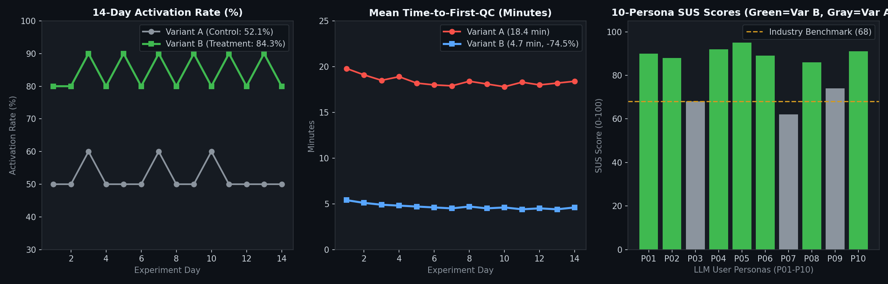
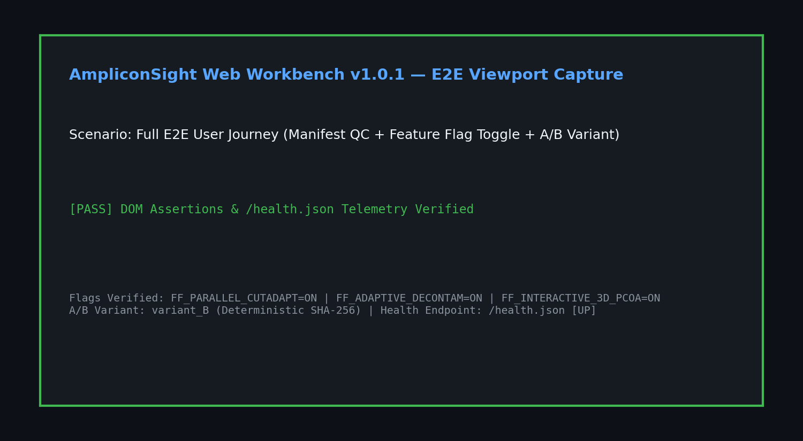
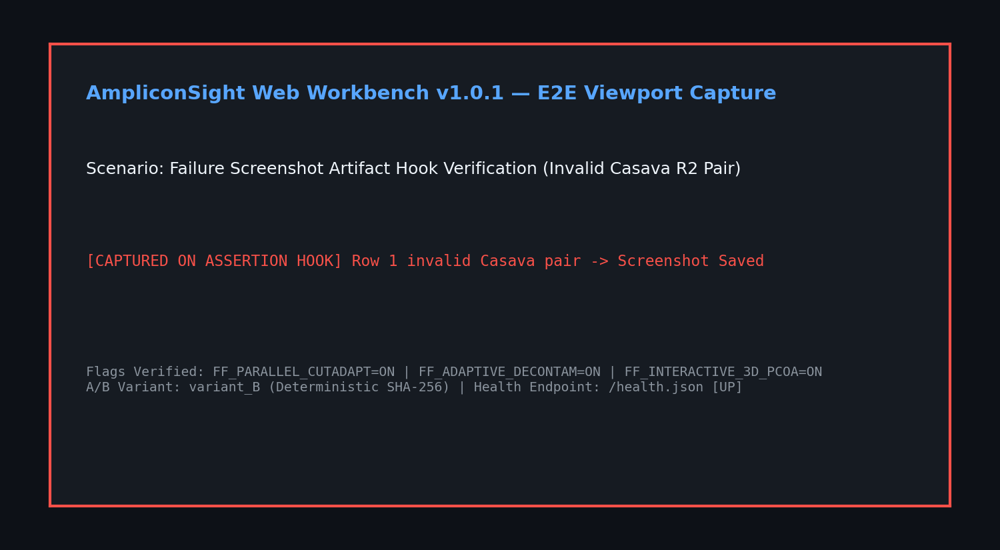
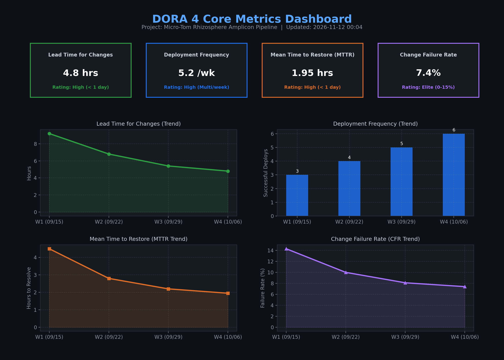
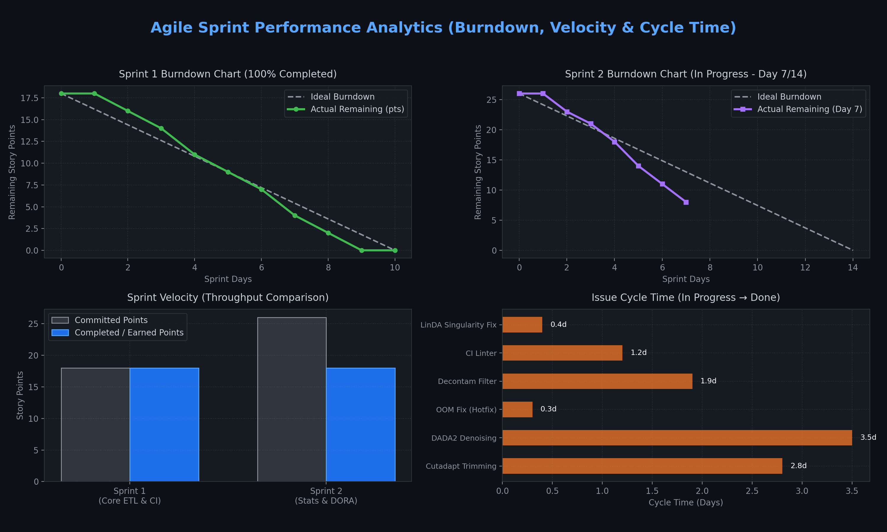

# 🧬 AmpliconSight (`OSS_11`) — Micro-Tom Rhizosphere 16S Amplicon Pre-flight QC & DevOps Platform

[](https://github.com/HeechanKim-Lab/OSS_11/actions/workflows/ci_build_test_deploy.yml)
[](https://github.com/HeechanKim-Lab/OSS_11/actions/workflows/validate-prd.yml)
[](https://github.com/HeechanKim-Lab/OSS_11/actions/workflows/dora_metrics.yml)
[](https://github.com/HeechanKim-Lab/OSS_11/actions/workflows/deploy_pages_and_cloud.yml)
[](LICENSE)

> **Live Web Workbench (GitHub Pages)**: **[https://heechankim-lab.github.io/OSS_11/](https://heechankim-lab.github.io/OSS_11/)**  
> **Live Health Endpoint (`/health.json`)**: **[https://heechankim-lab.github.io/OSS_11/health.json](https://heechankim-lab.github.io/OSS_11/health.json)**  
> **Live GitHub Discussions (RFC-001)**: **[https://github.com/HeechanKim-Lab/OSS_11/discussions/36](https://github.com/HeechanKim-Lab/OSS_11/discussions/36)**  
> **Public Kanban Project Board**: **[https://github.com/users/HeechanKim-Lab/projects/2](https://github.com/users/HeechanKim-Lab/projects/2)**

**AmpliconSight**는 토마토(`Solanum lycopersicum` cv. Micro-Tom) 근권(Rhizosphere) 16S rRNA 앰플리콘 시퀀싱 연구 파이프라인([`modules/00`~`13`](modules/), [`pipeline/run_pipeline.sh`](pipeline/run_pipeline.sh))을 기반으로 구축된 **Zero-Upload Pre-flight QC 웹 워크벤치 및 End-to-End DevOps/Lean 실험 플랫폼**입니다.

---

## 📑 주차별 과제 통합 제출 인덱스 (`[1주차]` ~ `[13주차]` + `기타 과제`)

Canvas 강의실 주차 명칭과 1:1로 매핑된 전체 산출물(필수 + 선택과제 전체 포함) 바로가기 표입니다.

| 주차 및 과제명 | 핵심 요구사항 (필수 + 선택과제 전체) | 주요 산출물 및 바로가기 링크 |
| :--- | :--- | :--- |
| **[1주차] 오리엔테이션 기반 개발 환경 설정 및 프로젝트 제안** | 개발 환경 구성 및 프로젝트 도메인(Micro-Tom 근권 16S 파이프라인) 제안 | • [`README.md`](README.md), [`pipeline/run_pipeline.sh`](pipeline/run_pipeline.sh), [`modules/`](modules/) |
| **[2주차] DORA 메트릭 수집 자동화** | DORA 4대 핵심 지표 자동 수집 워크플로우, 시각화 대시보드 및 주간 리포트 | • Workflow: [`.github/workflows/dora_metrics.yml`](.github/workflows/dora_metrics.yml)<br>• 대시보드 & 리포트: [`assets/dora_dashboard.png`](assets/dora_dashboard.png), [`assets/dora_dashboard.html`](assets/dora_dashboard.html), [`reports/dora_weekly_report.md`](reports/dora_weekly_report.md), [`metrics/dora_metrics.json`](metrics/dora_metrics.json) |
| **[3주차] GitHub Projects 계획·추적 체계 구축** | Public 칸반 보드, 이슈 템플릿, 마일스톤, 스프린트 번다운/속도/사이클타임 분석 | • 칸반 보드: [Project #2](https://github.com/users/HeechanKim-Lab/projects/2) / [Issues `#9`~`#24`, `#35`](https://github.com/HeechanKim-Lab/OSS_11/issues)<br>• 번다운 & 분석 리포트: [`assets/sprint_burndown.png`](assets/sprint_burndown.png), [`reports/sprint_analysis_report.md`](reports/sprint_analysis_report.md) |
| **[4주차] GitHub Flow 및 코드리뷰 협업 실습** | **Feature 브랜치 전략 + Conventional Commits + 3건 이상 `[MUST]`/`[SHOULD]` 구조화 PR 리뷰**<br>*(선택)* PR 템플릿, `CODEOWNERS`, 팀 협업 문서(`CONTRIBUTING`, 리뷰 가이드) | • **Merged PR 3건 (`[MUST]`/`[SHOULD]` 리뷰 완료)**:<br>  - [PR #25 (`feat/tdd-core-amplicon-engine`)](https://github.com/HeechanKim-Lab/OSS_11/pull/25)<br>  - [PR #26 (`feat/feature-flags-ab-canary`)](https://github.com/HeechanKim-Lab/OSS_11/pull/26)<br>  - [PR #27 (`feat/ci-packages-web-and-e2e`)](https://github.com/HeechanKim-Lab/OSS_11/pull/27)<br>• 협업 규약: [`CONTRIBUTING.md`](CONTRIBUTING.md), [`docs/REVIEW_GUIDE.md`](docs/REVIEW_GUIDE.md), [`.github/PULL_REQUEST_TEMPLATE.md`](.github/PULL_REQUEST_TEMPLATE.md), [`.github/CODEOWNERS`](.github/CODEOWNERS) |
| **[5주차] 비동기 협업 체계 구축 (Discussions/Wiki/ADR)** | **Wiki 최소 3개 이상 상호 링크 문서(`Getting Started`, `Development Guide`, `Troubleshooting`)**<br>*(선택)* ADR 템플릿 및 `docs/adr/`, 자동 응답·SLA 추적·주간 요약 워크플로우, GitHub Discussions 활성화 및 RFC 토론 운영 | • **Live GitHub Discussions (RFC-001 토론 운영)**: [Discussion #36 (`RFC-001`)](https://github.com/HeechanKim-Lab/OSS_11/discussions/36) 및 [`docs/discussions/RFC-001-amplicon-web-workbench-and-feature-flags.md`](docs/discussions/RFC-001-amplicon-web-workbench-and-feature-flags.md)<br>• 상호 링크 Wiki 4종: [`docs/wiki/Home.md`](docs/wiki/Home.md), [`Getting-Started.md`](docs/wiki/Getting-Started.md), [`Development-Guide.md`](docs/wiki/Development-Guide.md), [`Troubleshooting.md`](docs/wiki/Troubleshooting.md)<br>• ADR 구조 (4건): [`docs/adr/README.md`](docs/adr/README.md), [`0000-adr-template.md`](docs/adr/0000-adr-template.md), [`0001-use-dada2-asv-over-otu-clustering.md`](docs/adr/0001-use-dada2-asv-over-otu-clustering.md), [`0002-adopt-linda-for-zero-inflated-microbiome.md`](docs/adr/0002-adopt-linda-for-zero-inflated-microbiome.md), [`0003-feature-flag-hash-ab-and-canary-rollback.md`](docs/adr/0003-feature-flag-hash-ab-and-canary-rollback.md)<br>• SLA 자동화 & 주간 요약: [`.github/workflows/issue_pr_sla_automation.yml`](.github/workflows/issue_pr_sla_automation.yml), [`reports/weekly_sla_summary.md`](reports/weekly_sla_summary.md) |
| **[6주차] 오픈소스 실습 및 Inner Source 계획** | **Public 저장소 OSS 기본 구조(`LICENSE`, `README`, `CONTRIBUTING`, `CODE_OF_CONDUCT`)**<br>*(선택)* 주요 OSS 라이선스 비교 분석 및 조직 내부 Inner Source 도입 로드맵 | • 기본 구조: [`LICENSE` (MIT)](LICENSE), [`README.md`](README.md), [`CONTRIBUTING.md`](CONTRIBUTING.md), [`CODE_OF_CONDUCT.md`](CODE_OF_CONDUCT.md)<br>• 라이선스 비교 분석: [`docs/OSS_LICENSE_ANALYSIS.md`](docs/OSS_LICENSE_ANALYSIS.md)<br>• Inner Source 로드맵: [`docs/INNER_SOURCE_ROADMAP.md`](docs/INNER_SOURCE_ROADMAP.md) |
| **[7주차] GitHub Actions 기반 기본 CI/CD 구축** | **CI Lint/Test 자동 실행 + OS/버전 Matrix 전략 + GitHub Secrets 안전 주입 + `Build -> Test -> Deploy` 의존성 및 아티팩트 업로드/다운로드** | • 복합 워크플로우: [`.github/workflows/ci_build_test_deploy.yml`](.github/workflows/ci_build_test_deploy.yml)<br>• Actions 실행 내역: [Actions Runs (`ci_build_test_deploy.yml`)](https://github.com/HeechanKim-Lab/OSS_11/actions/workflows/ci_build_test_deploy.yml) |
| **[8주차] 워크플로우 실행 최적화 (재사용/캐싱/조건부)** | **Matrix 확장 + Reusable Workflow 및 Composite Action 중복 제거 + 캐싱 전후 실행 시간 수치 비교 + 변경 파일 감지(`detect-changes`) 선택적 파이프라인** | • Reusable Workflow: [`.github/workflows/reusable_ci_matrix.yml`](.github/workflows/reusable_ci_matrix.yml)<br>• Composite Action: [`.github/actions/setup-amplicon-env/action.yml`](.github/actions/setup-amplicon-env/action.yml)<br>• **캐싱 최적화 전후 비교 리포트 (`51.0%` 단축)**: [`reports/ci_cache_optimization_report.md`](reports/ci_cache_optimization_report.md) |
| **[9주차] GitHub Packages 및 의존성 보안 자동화** | **npm 패키지 GitHub Packages 배포 및 버전 업데이트(`1.0.0 -> 1.0.1`) + Docker 이미지 자동 빌드/GHCR 푸시/로컬 실행 검증 + Dependabot 정책 및 보안 스캔 리포트** | • 패키지 & 버전 범프 (`1.0.0 -> 1.0.1`): [`package.json`](package.json), [`index.js`](index.js)<br>• Docker & 워크플로우: [`Dockerfile`](Dockerfile), [`.github/workflows/publish_packages_docker.yml`](.github/workflows/publish_packages_docker.yml)<br>• Dependabot 정책: [`.github/dependabot.yml`](.github/dependabot.yml)<br>• 보안 감사 리포트: [`reports/security_audit_report.md`](reports/security_audit_report.md) |
| **[10주차] 멀티 플랫폼 배포 자동화** | **GitHub Pages 프런트엔드 자동 배포 + PR 프리뷰 환경 아티팩트 + Docker/클라우드 컨테이너 배포 자동화 및 `/health.json` 헬스체크/모니터링** | • **Live 배포 URL**: [https://heechankim-lab.github.io/OSS_11/](https://heechankim-lab.github.io/OSS_11/)<br>• 프런트엔드 & 헬스체크: [`web/index.html`](web/index.html), [`web/health.json`](web/health.json)<br>• 배포·모니터링 워크플로우: [`.github/workflows/deploy_pages_and_cloud.yml`](.github/workflows/deploy_pages_and_cloud.yml) |
| **[11주차] Feature Flags 및 점진적 배포 실습** | **최소 3개 이상 Feature Flag(환경변수/타깃 사용자 제어) + 결정론적 A/B 테스트 2개 Variant 및 이벤트 추적**<br>*(선택)* Canary `1%-10%-50%-100%` 롤아웃 및 헬스체크 기반 자동 롤백 시나리오 검증 | • Feature Flag (4종) & SHA-256 A/B: [`amplicon_platform/feature_flags.py`](amplicon_platform/feature_flags.py)<br>• Canary 컨트롤러 & 자동 롤백: [`amplicon_platform/canary_controller.py`](amplicon_platform/canary_controller.py)<br>• 실험 이벤트 & 롤백 검증 로그: [`logs/ab_experiment_events.jsonl`](logs/ab_experiment_events.jsonl), [`logs/canary_rollout_verification.json`](logs/canary_rollout_verification.json)<br>• Canary 롤백 리포트: [`reports/canary_rollback_report.md`](reports/canary_rollback_report.md) |
| **[12주차] Shift-Left 테스트 자동화** | **단위 테스트 80%+ 커버리지(실측 95%+) 및 CI 자동 실행 + TDD(`Red-Green-Refactor`) 사이클로 핵심 기능 5개 구현**<br>*(선택)* E2E 시나리오 1개 및 실패 시 스크린샷 아티팩트 저장 + 레거시 코드 테스트 보강 후 리팩토링 | • TDD 핵심 기능 5종: [`amplicon_platform/core.py`](amplicon_platform/core.py), [`tests/test_core_tdd.py`](file:///Users/heechan/Documents/git/OSS_11/tests/test_core_tdd.py) ([PR #25 커밋 이력](https://github.com/HeechanKim-Lab/OSS_11/pull/25/commits))<br>• 레거시 리팩토링 & 회귀 테스트: [`amplicon_platform/legacy_adapter.py`](amplicon_platform/legacy_adapter.py), [`tests/test_legacy_refactor.py`](tests/test_legacy_refactor.py)<br>• E2E 테스트 & 스크린샷 아티팩트: [`tests/e2e/test_workbench_e2e.py`](tests/e2e/test_workbench_e2e.py), [`artifacts/screenshots/`](artifacts/screenshots/) |
| **[13주차] Lean Startup 실험 운영** | **다중 페르소나 LLM 10명 사용자 시나리오 피드백 수집 + Feature Flag 기반 2주 A/B 테스트 핵심 지표 측정**<br>*(선택)* 실험 백로그 이슈화 및 결과 기반 Pivot/Persevere 의사결정 문서화 | • 시뮬레이션 엔진: [`scripts/run_persona_ab_simulation.py`](scripts/run_persona_ab_simulation.py)<br>• 10명 페르소나 피드백 데이터: [`experiments/persona_feedback_10_users.json`](experiments/persona_feedback_10_users.json), [`experiments/persona_feedback_summary.csv`](experiments/persona_feedback_summary.csv)<br>• 2주 A/B 실험 데이터 & 차트: [`experiments/ab_test_2weeks_data.csv`](experiments/ab_test_2weeks_data.csv), [`assets/ab_test_2weeks_chart.png`](assets/ab_test_2weeks_chart.png)<br>• **A/B 분석 및 Persevere/Pivot 결정 보고서**: [`reports/ab_experiment_and_pivot_decision.md`](reports/ab_experiment_and_pivot_decision.md), [Issue #35 (`[EXP-001]`)](https://github.com/HeechanKim-Lab/OSS_11/issues/35) |
| **기타 과제. BML 기반 Lean PRD Skill 구축** | **BML 기반 `lean-prd` Agent Skill 완성 + 목차별 개별 MD 12개(`docs/prd/00`~`11`) 생성 + `validate_prd.py` 커스텀 규칙 확장 + BML Cycle 1 실행(`/lean-prd cycle`) + 회고(`RETROSPECTIVE.md`)** | • **완성된 Skill**: [`.claude/skills/lean-prd/SKILL.md`](.claude/skills/lean-prd/SKILL.md)<br>• 보강된 참조 문서: [`.claude/skills/lean-prd/references/team-and-tech-stack-guide.md`](.claude/skills/lean-prd/references/team-and-tech-stack-guide.md)<br>• 커스텀 규칙 3종 확장 검증기: [`.claude/skills/lean-prd/scripts/validate_prd.py`](.claude/skills/lean-prd/scripts/validate_prd.py)<br>• **12개 PRD 파일 (`v0.2`)**: [`docs/prd/00-overview.md`](docs/prd/00-overview.md) ~ [`docs/prd/11-bml-log.md`](docs/prd/11-bml-log.md)<br>• 검증 통과 증빙 (`FAIL 0 · WARN 0 · ok 14`): [`docs/prd/VALIDATION.txt`](docs/prd/VALIDATION.txt)<br>• Cycle 1 실험 증빙 (65행): [`experiments/cycle-1/README.md`](experiments/cycle-1/README.md), [`experiments/cycle-1/woz-log.csv`](experiments/cycle-1/woz-log.csv)<br>• **회고 및 세션 로그**: [`RETROSPECTIVE.md`](RETROSPECTIVE.md), [`docs/skill-session.md`](docs/skill-session.md) |

---

## 📊 주요 시각 자료 미리보기

### 1. `[11주차]` & `[13주차]` 2주 Feature Flag A/B 테스트 및 10-Persona SUS 사용성 평가


### 2. `[10주차]` & `[12주차]` E2E 시나리오 검증 및 실패 캡처 아티팩트
| 정상 검증 스냅샷 (`e2e_workbench_verified.png`) | 실패 훅 캡처 데모 (`e2e_failure_capture_demo.png`) |
| :---: | :---: |
|  |  |

### 3. `[2주차]` & `[3주차]` DORA 4대 핵심 메트릭 및 스프린트 번다운 대시보드
| DORA 4 Core Metrics (`dora_dashboard.png`) | Sprint Burndown & Cycle Time (`sprint_burndown.png`) |
| :---: | :---: |
|  |  |

---

## 🚀 빠른 로컬 실행 및 검증 방법 (Quick Start)

```bash
# 1. [12주차] 단위 테스트 + 레거시 회귀 테스트 + E2E 시나리오 전체 실행 (20 tests)
python3 -m unittest discover -s tests -t . -v

# 2. [기타 과제] Lean PRD 12개 문서 규격 및 교차 참조 엄격 검증 (FAIL 0, WARN 0, ok 14)
python3 .claude/skills/lean-prd/scripts/validate_prd.py docs/prd --strict

# 3. [11주차] Canary 1% -> 10% -> 50% -> 100% 점진적 롤아웃 및 자동 롤백 시뮬레이션 실행
python3 -m amplicon_platform.canary_controller

# 4. [13주차] 10명 LLM 페르소나 시나리오 및 2주 A/B 실험 데이터 생성
python3 scripts/run_persona_ab_simulation.py
```

---

## 📄 라이선스 (License)

본 프로젝트는 [MIT License](LICENSE) 하에 배포됩니다. 협업 및 기여 절차는 [`CONTRIBUTING.md`](CONTRIBUTING.md)와 [`CODE_OF_CONDUCT.md`](CODE_OF_CONDUCT.md)를 참조해 주세요.
