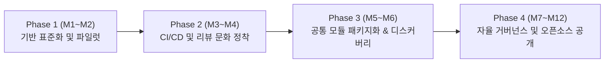

# 조직 내부 적용을 위한 Inner Source 도입 로드맵 (Inner Source Adoption Roadmap)

> **[과제 3 - 선택과제]** 대학 연구실 및 바이오인포매틱스/SW 융합 연구 조직 내부의 사일로(Silo)를 해소하고 오픈소스 협업 방식을 내재화하기 위한 **Inner Source 4단계 도입 로드맵**입니다.

---

## 1. 도입 배경 및 문제 정의 (Why Inner Source?)

기존 연구실 및 개발 조직에서는 각 연구원/개발자가 개인 로컬 PC나 폐쇄된 폴더에서 분석 스크립트(` arabidopsis-microplastic-rnaseq`, `microtom-rhizosphere-amplicon`, `plant-epigenomics-wetlab` 등)를 개별 관리하여 다음과 같은 문제가 발생했습니다:
1. **코드 중복 및 재발명**: FASTQ QC, Cutadapt 트리밍, 통계 시각화 코드가 프로젝트마다 중복 작성됨.
2. **인수인계 단절 (Bus Factor = 1)**: 담당 연구원 졸업 시 파이프라인 실행 환경과 파라미터 히스토리가 유실됨.
3. **품질 검증 부재**: 코드 리뷰와 자동화된 CI 테스트 없이 분석 결과가 산출되어 런타임 버그(OOM, Zero-inflation 에러 등)가 뒤늦게 발견됨.

이를 해결하기 위해 오픈소스의 개발 문화(투명한 저장소, Feature 브랜치 + PR 기반 `[MUST]`/`[SHOULD]` 코드 리뷰, CI/CD 자동 검증, 표준 문서화)를 조직 내부에 이식하는 **Inner Source 전략**을 수립합니다.

---

## 2. Inner Source 4단계 도입 로드맵

### Phase 1: 기반 표준화 및 파일럿 저장소 구축 (1~2개월)
- **목표**: 산재된 개인 스크립트를 단일 표준 Git 저장소 구조로 통합.
- **핵심 과제**:
  - 모든 내부 저장소에 `README.md`, `CONTRIBUTING.md`, `CODEOWNERS`, 이슈/PR 템플릿 의무화.
  - 파일럿 프로젝트(`OSS_11 / AmpliconSight`) 선정 및 GitHub Projects 칸반 보드(5단계 워크플로우) 도입.
- **성공 지표(KPI)**: 파일럿 저장소 PR 템플릿 준수율 100%, 이슈 기반 작업 추적률 90% 이상.

### Phase 2: 구조화된 코드 리뷰 및 자동화 게이트 정착 (3~4개월)
- **목표**: Trusted Committer(핵심 메인테이너) 지정 및 품질 검증 자동화.
- **핵심 과제**:
  - `main` 브랜치 직접 Push 금지(Branch Protection) 및 최소 1인 이상의 `[MUST]`/`[SHOULD]` 구조화 코드 리뷰 필수화.
  - GitHub Actions 기반 단위 테스트 커버리지 80% 게이트 및 DORA 4대 지표 자동 수집 적용.
  - 중요 아키텍처 변경 시 `docs/adr/`에 기술결정기록(ADR) 작성.
- **성공 지표(KPI)**: PR 첫 리뷰 응답 SLA(24시간 이내) 준수율 85%↑, 변경 실패율(CFR) 10% 이하 유지.

### Phase 3: 내부 공통 패키지 레지스트리 및 재사용 생태계 확장 (5~6개월)
- **목표**: 프로젝트 간 중복 코드를 사내 공용 패키지 및 컨테이너로 추상화.
- **핵심 과제**:
  - 공통 QC·통계 모듈을 GitHub Packages(`npm` / `PyPI`)와 GHCR Docker 이미지로 배포하여 타 프로젝트(`arabidopsis-rnaseq` 등)에서 `import`만으로 재사용.
  - GitHub Wiki 및 Discussions(RFC)를 통한 조직 내 기술 Q&A 지식 베이스 일원화.
- **성공 지표(KPI)**: 타 연구/개발 프로젝트의 공통 패키지 재사용 건수 3건 이상, 신규 파이프라인 구축 리드타임 50% 단축.

### Phase 4: 자율 거버넌스 성숙 및 외부 오픈소스(Public OSS) 전환 (7~12개월)
- **목표**: 검증된 내부 자산을 글로벌 오픈소스 커뮤니티로 공개 및 기여 보상 체계 확립.
- **핵심 과제**:
  - 연구실/조직 내 타 팀 PR 리뷰 및 이슈 해결 기여도를 연구/업무 평가 지표에 반영.
  - MIT / Apache-2.0 라이선스 검증 및 민감 데이터 스캔(`npm audit` / Secret scanning) 통과 모듈의 Public 전환.
- **성공 지표(KPI)**: 외부 오픈소스 릴리즈 연 2건 이상, 내부 개발자 만족도(DX Survey) 4.5/5.0 이상.
