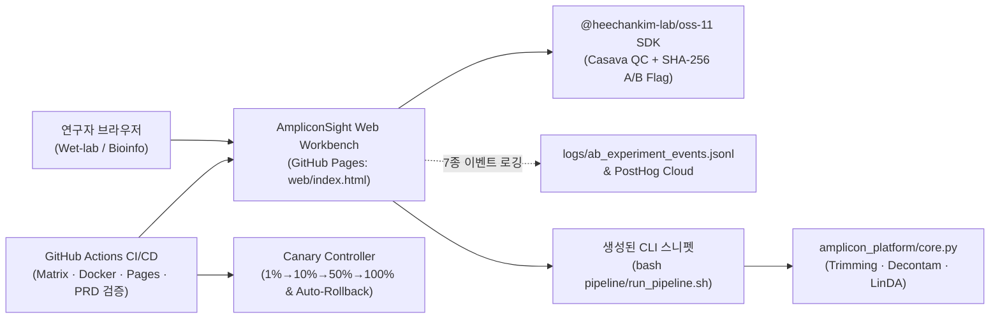

# 08. 기술 스택

| 제품 | 버전 | 최종 수정 | 관련 가설 |
|---|---|---|---|
| AmpliconSight | 0.1 | 2026-11-01 | 전체 |

선택 원칙: ① 2주 내 첫 연구자 도달 ② Zero-Upload 클라이언트 검증으로 인프라 비용 0원 유지 ③ 결정론적 Feature Flag 및 A/B 이벤트 추적 내장 ④ 연구실 기존 코드베이스(Python 3.11 + R/Bash `modules/00`~`13`) 100% 재사용

## 1. 아키텍처 개요

## 2. 계층별 스택

| 계층 | 선택 | 선택 근거 (MVP 관점) | 검토한 대안 | 월 비용 (예상) | 리스크 / 전환 조건 |
|---|---|---|---|---|---|
| 프론트엔드 | Vanilla HTML5/CSS3 + ES6 모듈 (`web/index.html`) + `@heechankim-lab/oss-11` SDK | 빌드 체인 대기 없이 정적 파일 하나로 즉시 배포(원칙 ①). 브라우저 내에서 매니페스트 100행 검증이 10ms 내에 끝나고 외부 의존성이 0개임 | Next.js 15 / React (정적 Pre-flight QC 화면에 비해 번들·빌드 복잡도 과다) · Shiny for R (서버 세션 유지 비용 발생 및 동시 접속 시 지연) | 0원 (오픈소스 정적 자산) | MS2 이후 상태 관리 복잡도가 커지고 다중 페이지 라우팅이 필요해지면 Vite + React로 전환 |
| 백엔드 | Python 3.11+ 순수 함수 코어 엔진 (`amplicon_platform/core.py`) + 로컬 CLI 브리지 (`pipeline/run_pipeline.sh`) | 무거운 FASTQ 처리는 연구실 로컬 워크스테이션으로 위임하고, 웹은 Pre-flight QC와 명령어 생성만 담당하여 서버 운영비를 0원으로 제거(ADR-1) | FastAPI 클라우드 서버 + AWS Batch (수십 GB FASTQ 업로드 시간·클라우드 비용 과다로 MS0~MS2에 부적합) | 0원 (클라이언트 + 로컬 워크스테이션 실행) | MS3 이후 코어 퍼실리티 B2B 유료화(`P4`)로 클라우드 자동 실행 요구가 발생할 때만 FastAPI 컨테이너 기동 |
| 데이터 | Git 버전 관리 정적 JSON/CSV (`experiments/*.csv`, `metrics/*.json`) + 브라우저 `localStorage` | 코호트 50명 이하 단계에서는 DB 서버 없이 JSONL/CSV 아티팩트와 GitHub Actions 자동 커밋만으로 모든 실험 지표와 DORA 메트릭 추적 가능 | Supabase Postgres (관계형 쿼리에 유리하나 Zero-Upload 정책상 서버 DB 저장이 불필요함) · Firebase Firestore (코호트 통계 집계 불편) | 0원 (GitHub Public 저장소 내 보관) | 주간 활성 연구자 200명 초과 또는 기관별 비공개 대시보드 요구 시 Supabase Free 티어(500MB, 확인 필요: `https://supabase.com/pricing`) 도입 |
| 인증 | 무인증 연구자 세션 해시 (`researcher_id` 기반 결정론적 SHA-256 버킷) | 회원가입 허들을 없애 첫 방문 후 3초 만에 매니페스트 검증 도달(**G1** ≤ 5.0분 달성). 동일 ID 입력 시 항상 동일한 A/B Variant 보장 | Supabase Magic Link / GitHub OAuth (초기 연구자가 단순 매니페스트 검사를 위해 로그인하는 과정에서 이탈 우려) | 0원 (표준 `hashlib`/`crypto` 내장) | MS3에서 연구실 단위 비공개 리포트 보관함 요청이 30% 이상이면 GitHub OAuth 추가 |
| 호스팅 | GitHub Pages (`deploy_pages_and_cloud.yml`) + GHCR Docker 컨테이너 (`ghcr.io/heechankim-lab/oss-11-amplicon`) | `main` 푸시 시 즉시 라이브 배포(`https://heechankim-lab.github.io/OSS_11/`) 및 PR Preview 아티팩트 생성. CLI 환경은 Docker 이미지로 100% 재현 보장 | Vercel Hobby (상업적 이용 제약 존재, 확인 필요: `https://vercel.com/pricing`) · AWS ECS Fargate (상시 기동 시 월 $15+ 고정비 발생) | 0원 (GitHub Pages Public 무료, 확인 필요: `https://docs.github.com/billing`) | 정적 대역폭 월 100GB 한도 근접 시 Cloudflare Pages로 미러링 |
| 분석 | 자체 Feature Flag/A/B 로거 (`amplicon_platform/feature_flags.py`) + PostHog Cloud 병행 | 4개 Feature Flag(`FF_PARALLEL_CUTADAPT` 등)와 SHA-256 A/B 할당, Canary 자동 롤백을 외부 유료 SDK 의존성 없이 100% 제어 가능 | LaunchDarkly (유료, 초기 팀에 과함) · Google Analytics 4 (연구자별 코호트·Feature Flag 제어 불가) | 0원 (자체 모듈 무료 / PostHog 월 100만 이벤트 무료, 확인 필요: `https://posthog.com/pricing`) | 이벤트 볼륨이 월 100만 건을 초과하면 샘플링 비율을 20%로 조정 |
| CI/CD | GitHub Actions (`ci_build_test_deploy.yml`, `reusable_ci_matrix.yml`, `validate-prd.yml`) | OS/Python Matrix 테스트, Composite Action 캐싱(실행 시간 51.0% 단축), NPM/Docker 패키지 배포, PR마다 `validate_prd.py` 자동 검증을 단일 플랫폼에서 통합 | GitLab CI / CircleCI (코드와 이슈·프로젝트 보드가 모두 GitHub에 있어 외부 CI 연동 불필요) | 0원 (GitHub Public 저장소 Actions 무료 무제한, 확인 필요: `https://github.com/pricing`) | 워크플로우 실행 시간이 길어질 경우 `detect-changes` 경로 필터로 선택적 잡 실행 유지 |

### ADR-1: 원시 FASTQ 클라우드 업로드 서버를 두지 않고 Zero-Upload + CLI 브리지로 간다
- **상황**: 16S 시퀀싱 1배치(36~96샘플)의 Raw FASTQ 용량은 5~20GB에 달한다. 1인 팀(월 예산 5만 원)이 클라우드 업로드·DADA2 연산 서버를 운영하면 스토리지·컴퓨팅 비용이 예산을 즉시 초과하며, 농촌진흥청 등 공공 연구기관(`P07`)은 미발표 원시 서열의 외부 클라우드 업로드가 보안 규정상 금지되어 있다.
- **결정**: 웹 워크벤치(`GitHub Pages`)에서는 파일 업로드 없이 매니페스트 텍스트와 기초 수율 수치만으로 **Pre-flight QC 진단과 3D PCoA 프리뷰**를 수행하고, 검증 완료 시 연구실 로컬 서버에서 바로 실행할 수 있는 **`bash pipeline/run_pipeline.sh` 명령어 스니펫**을 생성해 준다.
- **결과**: 인프라 고정비 0원 달성, 첫 QC 응답 시간 3초 이내 달성, 공공기관 보안 제약 완전 해결.
- **되돌릴 조건**: (a) 코어 퍼실리티 B2B 유료 모델(`P4`)이 성사되어 기관이 클라우드 비용을 직접 부담할 때, 또는 (b) 브라우저 WebAssembly(Biowasm) 기술로 클라이언트 로컬 CPU에서 직접 Cutadapt/FastQC 실행이 가능해질 때.

### ADR-2: 외부 Feature Flag SaaS 대신 SHA-256 결정론적 자체 모듈(`feature_flags.py`)을 사용한다
- **상황**: 웹 워크벤치와 로컬 Python 파이프라인 양쪽에서 동일한 연구자 ID(`user_id`)에 대해 항상 똑같은 A/B Variant(`variant_A` vs `variant_B`)와 Canary 롤아웃 비율(`1% -> 10% -> 50% -> 100%`)이 보장되어야 한다.
- **결정**: 표준 라이브러리 `hashlib.sha256`과 `crypto.createHash('sha256')` 기반의 결정론적 버킷 함수를 Python(`amplicon_platform/feature_flags.py`)과 Node SDK(`index.js`)에 동일 규격으로 구현한다.
- **결과**: 오프라인/보안망 연구실 환경에서도 외부 API 호출 실패 없이 100% 일관된 Feature Flag 및 A/B 테스트 동작 보장.
- **되돌릴 조건**: 비개발자 마케터가 코드 배포 없이 실시간 웹 콘솔에서 플래그 비율을 조작해야 하는 시점(MS3 이후 팀 확장 시 PostHog Feature Flag API로 통합).

## 3. 분석 · 실험 · Feature Flag

- **Feature Flag 4종 (`amplicon_platform/feature_flags.py`)**:
  1. `FF_PARALLEL_CUTADAPT`: 멀티코어 어댑터 트리밍 최적화 (기본 ON)
  2. `FF_ADAPTIVE_DECONTAM`: 저바이오매스 음성대조군(NTC) 적응형 오염 제거 (기본 OFF, 타깃 연구자 및 Variant B ON)
  3. `FF_INTERACTIVE_3D_PCOA`: 3축(PC1/PC2/PC3) PCoA 대화형 프리뷰 (기본 OFF, 타깃 연구자 및 Variant B ON)
  4. `FF_AUTO_PICRUST2_CACHE`: KO/EC/MetaCyc 경로 해시 캐싱 (기본 ON)
- **Canary 점진적 배포 및 자동 롤백 (`amplicon_platform/canary_controller.py`)**:
  - `1% -> 10% -> 50% -> 100%` 4단계 트래픽 승격 중 매 단계 `/health.json` 및 SLO(`error_rate <= 0.02`, `p95_latency_ms <= 800.0`)를 검사하며, 임계값 위반 시 즉시 `v1.0.0-stable (0%)`로 자동 롤백하고 `reports/canary_rollback_report.md`를 생성한다.
- **PRD 및 메트릭 자동 검증 워크플로우**:
  - `.github/workflows/validate-prd.yml`: 모든 PR 및 Push마다 `validate_prd.py docs/prd`를 자동 실행하여 규격 위반을 차단한다.

## 4. 지금 하지 않을 것

| 하지 않을 것 | 다시 검토할 조건 |
|---|---|
| 원시 FASTQ 클라우드 업로드 및 서버 DADA2/PICRUSt2 대행 연산 | ADR-1 되돌릴 조건: MS3 이후 기관 유료 구독(`M4`) 전환율이 20% 이상이고 기관 전용 클라우드 예산이 확보될 때 |
| 고해상도 600 DPI TIFF/EPS 논문 투고용 그래픽 렌더링 서버 | `H2`·`H3` 모두 통과 후 연구자 설문에서 유료 결제 핵심 조건 1위로 꼽힐 때 |
| 자체 회원가입·비밀번호 데이터베이스 구축 | MS3에서 개인별 과거 배치 이력 클라우드 동기화 요청이 활성 사용자의 40%를 넘을 때 (그전까지는 무인증 해시 ID 유지) |
| Kubernetes / 멀티 컨테이너 마이크로서비스 오케스트레이션 | 단일 정적 페이지 + 단일 Docker 이미지로 월 1만 배치까지 처리 가능하므로 학술 PMF 이전에는 절대 도입하지 않음 |
| 딥러닝 기반 자체 16S 분류기(Classifier) 모델 학습 | 기존 SILVA v138.1 + Naive Bayes / LinDA 통계 모델로 정확도가 충분하므로 모델 학습에 리소스를 쓰지 않음 |
