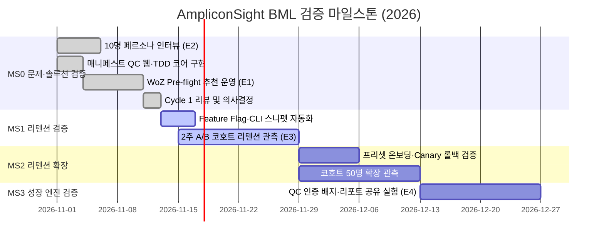

# 09. 마일스톤

| 제품 | 버전 | 최종 수정 | 관련 가설 |
|---|---|---|---|
| AmpliconSight | 0.1 | 2026-11-01 | H1~H4 |

마일스톤은 기능 개발 단위가 아니라 **가설 검증 단위**다. 각 마일스톤의 종료 조건은 `05-metrics.md` §2의 목표치와 100% 일치한다. (총 8주, 2주 × 4 마일스톤: `2026-11-01` ~ `2026-12-26`).

## 1. 마일스톤 개요

| ID | 이름 | 기간 | 검증 가설 | 핵심 산출물 | 종료 조건 | No-Go 시 | 상태 |
|---|---|---|---|---|---|---|---|
| MS0 | 문제·솔루션 검증 (Wizard of Oz + 매니페스트 QC) | W1~W2 (11/01~11/14) | H2, H1 | Casava 1.8 매니페스트 검증 화면, Pre-flight QC 추천 카드(WoZ 검수), 수락/거절 버튼, 10명 페르소나 인터뷰 | M2 추천 수락률 ≥ 60% (노출 60건+) · M1 문제 확인율 ≥ 70% (N=10) | M2 < 35% → P1 · M1 < 40% → P2 | 진행 중 |
| MS1 | 리텐션 검증 (자동화 & Feature Flag A/B) | W3~W4 (11/15~11/28) | H3 | `amplicon_platform` 순수 함수 연동, Feature Flag 4종(`FF_INTERACTIVE_3D_PCOA` 등), 2주 A/B 테스트 운영 | M3 D14 코호트 리텐션 ≥ 50% (코호트 20명+) · G1 완료 시간 ≤ 5.0분 · G2 성공률 ≥ 85% | M3 < 30% → P3 | 계획 |
| MS2 | 리텐션 확장 (프리셋 온보딩 & Canary 안정화) | W5~W6 (11/29~12/12) | H3 (N=50 재확인), H1 | 교육용 샘플 데이터셋 3종 프리셋, Canary `1%→10%→50%→100%` 자동 롤백 검증, 코호트 50명 확장 | M3 D14 코호트 리텐션 ≥ 50% (코호트 50명+) · 온보딩 첫 검증 도달률 ≥ 80% | M3 < 30% 2회 연속 → P3 · 세그먼트 한계 시 P2 | 계획 |
| MS3 | 성장 엔진 검증 (QC 인증 리포트 공유) | W7~W8 (12/13~12/26) | H4 | "AmpliconSight QC Verified" 배지 및 마크다운 리포트 공유 링크 생성, 코어 퍼실리티 안내문 실험 | M5 리포트 공유율 ≥ 20% · K-factor ≥ 0.25 · NSM 주 40배치 | 공유율 < 8% → 코어 퍼실리티 B2B 채널 전환(P4 검토) | 계획 |

## 2. 마일스톤 상세

### MS0 — 문제·솔루션 검증 (11/01~11/14)
- 검증 가설: H2 (Pre-flight QC 추천 파라미터 수락), H1 (매니페스트·오염 기준 재실행 고통 존재) 병행
- MVP 유형: Wizard of Oz + Single-feature Hybrid
- 산출물: (a) `web/index.html` 매니페스트 검증기 및 수락/거절 액션 UI (b) `amplicon_platform/core.py` TDD 핵심 검증 함수 5종 (c) 10명 다중 페르소나(`Persona-01`~`Persona-10`) 인터뷰 및 시나리오 평가 (d) `experiments/cycle-1/woz-log.csv` 60건 이상 수락률 집계
- 종료 조건: M2 추천 수락률 ≥ 60% (추천 노출 60건 이상, 5일) 및 M1 인터뷰 문제 확인율 ≥ 70% (N=10)
- Go: MS1 착수 — 추천 카드 완전 자동화, `run_pipeline.sh` CLI 명령어 자동 생성기 및 Feature Flag A/B 테스트 가동
- No-Go: M2 < 35% → `10-risks-and-pivot.md` **P1** (Zoom-in: 웹 UI를 걷어내고 순수 CLI 명령어 생성 스크립트로 축소). M1 < 40% → **P2** (Customer Segment: 시퀀싱 코어 퍼실리티 매니저 타깃으로 전환)
- 담당: 본인 (PM 0.25 + 개발 0.25) + 연구실 포닥 자문 (0.05)

### MS1 — 리텐션 검증 (11/15~11/28)
- 검증 가설: H3 (3D PCoA 프리뷰 및 적응형 Decontam 추천이 D14 코호트 리텐션을 50% 이상으로 끌어올린다)
- MVP 유형: Automated Single-feature Workbench + Deterministic SHA-256 A/B Testing
- 산출물: (a) `@heechankim-lab/oss-11` SDK v1.0.1 배포 (b) Feature Flag 4종 및 `assign_ab_variant` 50:50 A/B 실험(`Variant A` vs `Variant B`) 2주 운영 (c) E2E 시나리오 테스트(`tests/e2e/test_workbench_e2e.py`) 및 스크린샷 아티팩트
- 종료 조건: M3 D14 코호트 리텐션 ≥ 50% (코호트 20명 이상, Variant A 기준 38.6%) · Guardrail G1 ≤ 5.0분, G2 ≥ 85%
- Go: MS2 착수 — 학부 실습생·타 연구실 대상 코호트 50명 확장 및 프리셋 온보딩 도입
- No-Go: M3 < 30% → `10-risks-and-pivot.md` **P3** (Zoom-out: 독립 웹 워크벤치를 포기하고 기존 QIIME2/Snakemake 파이프라인의 CLI 플러그인으로 편입)
- 담당: 본인 (PM 0.15 + 개발 0.30 + 분석 0.05)

### MS2 — 리텐션 확장 (11/29~12/12)
- 검증 가설: H3 (코호트 50명 규모에서 D14 리텐션 50% 재확인), H1 (타 대학원 신규 코호트 문제 확인율 재검증)
- MVP 유형: Automated Workbench + Preset Onboarding + Canary Rollout
- 산출물: (a) 교육용 샘플 프리셋 3종(정상·NTC 오염·저수율) 원클릭 로드 버튼 (b) Canary `1% -> 10% -> 50% -> 100%` 점진적 배포 및 SLO 위반 시 자동 롤백 검증(`reports/canary_rollback_report.md`) (c) 미재방문 연구자 5명 이탈 인터뷰
- 종료 조건: M3 D14 코호트 리텐션 ≥ 50% (코호트 50명+) · 신규 방문자 첫 검증 완료율 ≥ 80%
- Go: MS3 착수 — QC 인증 배지 공유 바이럴 실험(`E4`)
- No-Go: M3 < 30% 2회 연속 → **P3** 실행. 만약 타 연구실 인터뷰에서 문제 강도가 낮으면 **P2** 실행
- 담당: 본인 (0.50) + 조건부 UI 외주 (0.05)

### MS3 — 성장 엔진 검증 (12/13~12/26)
- 검증 가설: H4 (검증을 마친 연구자가 연구실 미팅·논문 보충자료용 QC 인증 리포트 링크를 공유해 신규 연구자를 데려온다)
- MVP 유형: Single-feature + Viral Badge Sharing
- 산출물: (a) "AmpliconSight Pre-flight QC Verified" 마크다운 배지 및 요약 리포트 링크 생성기 (b) 시퀀싱 코어 퍼실리티 납품 메일 템플릿 제휴 실험 (c) 기관 유료 도입 의향 설문(`M4`, 측정만)
- 종료 조건: M5 리포트 공유율 ≥ 20% · K-factor ≥ 0.25 · NSM 주 40배치 달성
- Go: 학술·기관 PMF 달성 — `07-team.md` §2에 따라 시각화 개발자 합류 및 코어 퍼실리티 B2B 라이선스(`P4`) 확장
- No-Go: M5 공유율 < 8% → 개인 간 바이럴을 중단하고 시퀀싱 코어 퍼실리티 B2B 제휴(`P4`)를 주 성장 채널로 전환
- 담당: 본인 (0.50) + 코어 퍼실리티 매니저 자문

## 3. GitHub 매핑

| PRD 요소 | GitHub 저장소 (`HeechanKim-Lab/OSS_11`) 매핑 |
|---|---|
| MS0~MS3 | GitHub Milestones (`Sprint 1: Core Amplicon QC & Preprocessing`, `Sprint 2: Diversity, Differential Abundance & CI Automation`) |
| H1~H4 & E1~E4 | GitHub Issues `#9`~`#24`, `#35` (`[EXP-001]`) +GitHub Project Kanban Board 자동 연동 |
| MVP In 기능 (FR1~FR7) | Feature Branch PR `#25` (TDD 코어), PR `#26` (Feature Flag·Canary), PR `#27` (Web·CI·Packages·E2E) |
| M2·M3·G1 지표 & DORA | `.github/workflows/dora_metrics.yml`, `.github/workflows/issue_pr_sla_automation.yml`, `experiments/ab_test_2weeks_data.csv` |
| PRD 형식 자동 검증 | `.github/workflows/validate-prd.yml` — 모든 Push/PR 시 `validate_prd.py docs/prd` 실행 |

## 4. 일정

