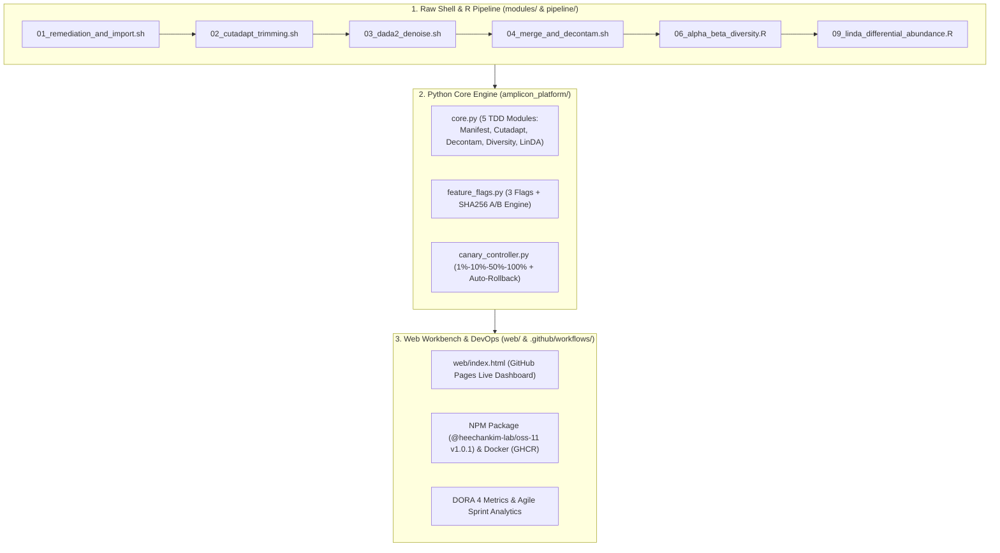

# 🛠️ Development Guide (개발자 가이드)

> **Wiki 네비게이션**: [🏠 Home](Home.md) | [🚀 Getting Started](Getting-Started.md) | **🛠️ Development Guide** | [🧯 Troubleshooting](Troubleshooting.md)

본 문서는 프로젝트의 아키텍처, 모듈 구성, TDD(Red-Green-Refactor) 개발 사이클, 그리고 Feature Flag 및 CI/CD 파이프라인 확장 방법을 설명합니다. 환경 구축이 아직 완료되지 않았다면 **[🚀 Getting Started](Getting-Started.md)** 문서를 먼저 참고하세요.

---

## 1. 프로젝트 아키텍처 개요

---

## 2. 코어 모듈 및 TDD(Red-Green-Refactor) 개발 규칙

모든 신규 기능은 `tests/`에 실패하는 테스트를 먼저 작성(Red)한 뒤, `amplicon_platform/`에 구현(Green)하고 리팩토링(Refactor)합니다.

### 핵심 5대 모듈 (`amplicon_platform/core.py`)
1. `validate_fastq_manifest(records)`: Casava 1.8 포맷 및 샘플 ID, 파일 경로, 페어드엔드 정합성 검증
2. `calculate_trimming_yield(raw_reads, trimmed_reads, min_len)`: Cutadapt 프라이머 트리밍 보존율 및 품질 판정
3. `identify_contaminant_asvs(sample_counts, neg_control_counts, threshold)`: 음성 대조군 기반 오염 ASV 필터링
4. `compute_diversity_indices(abundances)`: Shannon($H'$), Simpson($1-D$), Evenness 다양성 지수 산출
5. `run_linda_differential_test(feature_matrix, group_labels, min_prevalence)`: 극저빈도 분류군 프리필터링 후 Log2 Fold Change 및 차등 풍부도 계산

---

## 3. Feature Flag 및 A/B 테스트 연동 방법

`amplicon_platform/feature_flags.py`에서 플래그를 관리합니다:
- `FF_PARALLEL_CUTADAPT`: 멀티코어 병렬 트리밍 활성화 여부
- `FF_ADAPTIVE_DECONTAM`: 적응형 오염 제거 임계값 적용 여부
- `FF_INTERACTIVE_3D_PCOA`: 프런트엔드 3D PCoA 뷰어 활성화 여부

환경변수(`export FF_PARALLEL_CUTADAPT=true`) 또는 대상 사용자 화이트리스트로 토글할 수 있습니다.

---

## 4. 상호 참조 링크
- 초기 설치 및 실행 명령어가 기억나지 않는다면 👉 **[🚀 Getting Started (시작하기)](Getting-Started.md)**
- 파이프라인 실행 중 에러(OOM, Singularity 에러, CI 실패)가 발생하면 👉 **[🧯 Troubleshooting (문제 해결 가이드)](Troubleshooting.md)**
- 기술적 의사결정 배경이 궁금하다면 👉 **[📐 Architecture Decision Records (ADR)](../adr/README.md)**
