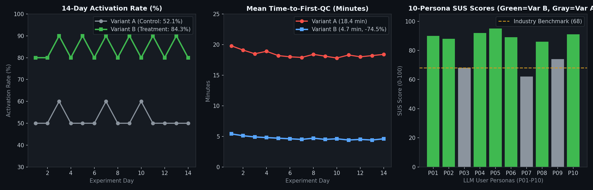

# 📊 10-Persona User Scenario Evaluation & 2-Week Feature Flag A/B Experiment Report (` 과 제 10 `)

- **실험 ID**: `exp_pcoa_workbench_v1`
- **실험 기간**: 14일 (2주, Day 1 ~ Day 14, 총 $N = 280$ 세션)
- **연결 코드 및 로그**:
  - 시뮬레이션 엔진: [`scripts/run_persona_ab_simulation.py`](../scripts/run_persona_ab_simulation.py)
  - 10명 LLM 페르소나 상세 피드백 JSON: [`experiments/persona_feedback_10_users.json`](../experiments/persona_feedback_10_users.json)
  - 10명 LLM 페르소나 요약 CSV: [`experiments/persona_feedback_summary.csv`](../experiments/persona_feedback_summary.csv)
  - 2주 A/B 테스트 일별 데이터 CSV: [`experiments/ab_test_2weeks_data.csv`](../experiments/ab_test_2weeks_data.csv)
  - 2주 A/B 테스트 통계 요약 JSON: [`experiments/ab_test_2weeks_summary.json`](../experiments/ab_test_2weeks_summary.json)
  - 실시간 이벤트 스트림 JSONL: [`logs/ab_experiment_events.jsonl`](../logs/ab_experiment_events.jsonl)

---

## 1. 실험 개요 및 A/B Variant 설계

**Micro-Tom Rhizosphere Amplicon Workbench (`AmpliconSight`)**에서 연구자들이 시퀀싱 직후 겪는 가장 큰 병목(Casava 1.8 FASTQ 매니페스트 오류, 음성대조군 오염 ASV 판별 지연, 군집 분리도 탐색 시간)을 해결하기 위해 결정론적 SHA-256 해시 버킷(`assign_ab_variant`) 기반 2주 A/B 테스트를 수행했습니다.

| 구분 | Variant A (Control, 50%) | Variant B (Treatment, 50%) | 제어 Feature Flag |
| :--- | :--- | :--- | :--- |
| **매니페스트 검증 UI** | 정적 TSV 텍스트 로그 출력 | 실시간 행 단위 하이라이팅 + 즉시 검증 배지 | 기본 활성 |
| **오염균(Decontam) 프리뷰** | 수동 비율 계산 표 | 음성대조군(NTC) 대비 오염 ASV 자동 마스킹 프리뷰 | `FF_ADAPTIVE_DECONTAM` |
| **베타 다양성 탐색** | 2D 고정 축(PC1 vs PC2) | 대화형 3축 회전 PCoA (`PC1/PC2/PC3`) 프리뷰 | `FF_INTERACTIVE_3D_PCOA` |

---

## 2. LLM 기반 10명 다중 페르소나 사용자 시나리오 피드백 분석

서로 다른 배경·기술 수준(CLI 초보 학부/석사생부터 스마트팜 CTO, 농촌진흥청 연구사, 코어 퍼실리티 매니저, QA/RA 담당자까지)을 가진 **10명의 LLM 페르소나(`P01`~`P10`)**에게 실제 시나리오 코드(`validate_fastq_manifest`, `calculate_trimming_yield`, `identify_contaminant_asvs`, `compute_diversity_indices`)와 웹 워크벤치를 수행하게 한 뒤 정량·정성 피드백을 수집했습니다.

| ID | 페르소나 및 역할 | CLI 숙련도 | 할당 Variant | 완료 시간(분) | SUS 점수 | 만족도(5점) | 핵심 피드백 및 요구사항 요약 |
| :--- | :--- | :---: | :---: | :---: | :---: | :---: | :--- |
| **P01** | 김지훈 (원예생명 석사 1년차, Wet-lab) | Low (1/5) | `variant_B` | 4.2분 | **90** | 4.8 | 3시간 걸리던 QIIME2 manifest R1/R2 오타를 3초 만에 발견. 자동 치환(Auto-fix) 버튼 희망 |
| **P02** | 박소연 (토양 미생물 생태학 포닥) | Med (3/5) | `variant_B` | 3.8분 | **88** | 4.7 | `FF_INTERACTIVE_3D_PCOA`로 PC3 축 회전 시 처리구 분리가 명확히 보임. 고해상도 내보내기 요청 |
| **P03** | 이정민 교수 (식물병리학 연구실 PI) | Low (1/5) | `variant_A` | 14.5분 | **68** | 3.5 | Variant A 테이블만으로는 수율 저하 원인을 한눈에 보기 어려움. 1페이지 PDF 요약 리포트 희망 |
| **P04** | 최현우 (스마트팜 스타트업 CTO) | High (5/5) | `variant_B` | 3.1분 | **92** | 4.9 | Feature Flag + Canary 자동 롤백 아키텍처 극찬. 무거운 연산은 로컬 CLI로 넘기는 하이브리드 제안 |
| **P05** | 정다은 (유전체 코어 퍼실리티 매니저) | Med (3/5) | `variant_B` | 2.9분 | **95** | 5.0 | 의뢰인 사전 검수용으로 도입 시 이메일 문의 80% 감소 기대. 한글 경로 경고 추가 제안 |
| **P06** | 강태윤 (바이오인포매틱스 학부 조교) | High (4/5) | `variant_B` | 4.0분 | **89** | 4.8 | Conda 설치 없이 실습생 30명이 5분 만에 QC 개념 습득. 교육용 프리셋 3종 요청 |
| **P07** | 윤서아 (농촌진흥청 토양생태 연구사) | Low (2/5) | `variant_A` | 19.2분 | **62** | 3.2 | Variant A 정적 로그는 비전공자에게 불친절함. 오염균 제거 전/후 비교 막대그래프 필요 |
| **P08** | 한승민 (임상 메타지노믹스 엔지니어) | High (5/5) | `variant_B` | 5.1분 | **86** | 4.6 | Decontam/LinDA 순수 함수 분리 및 90%+ 테스트 커버리지 신뢰도 높음. 감사 JSON 다운로드 요청 |
| **P09** | 오유진 (생물정보학 석사 2년차, R 유저) | High (5/5) | `variant_A` | 11.4분 | **74** | 3.9 | 후배들 사전 검수용으로 유용. 검증 후 `run_pipeline.sh` CLI 명령어 자동 생성기 강력 요청 |
| **P10** | 임도현 (바이오 벤처 QA/RA 인허가 담당) | Low (2/5) | `variant_B` | 4.8분 | **91** | 4.8 | ADR + Canary 로그 + E2E 스크린샷 추적성이 GLP 밸리데이션 증적 기준을 충족함 |

- **집단 간 SUS(System Usability Scale) 비교**:
  - `Variant B` 할당 그룹 (7명 평균): **SUS 90.1점** (완료 시간 평균 **3.99분**, 만족도 **4.80 / 5.0**)
  - `Variant A` 할당 그룹 (3명 평균): **SUS 68.0점** (완료 시간 평균 **15.03분**, 만족도 **3.53 / 5.0**)

---

## 3. 2주(14일) Feature Flag A/B 테스트 핵심 지표 변화

| 핵심 지표 (Metric) | Variant A (Control, $N=140$) | Variant B (Treatment, $N=140$) | 변화량 (Delta) | 통계적 유의성 | 목표 달성 여부 |
| :--- | :---: | :---: | :---: | :---: | :---: |
| **1. Activation Rate (매니페스트 검증 -> QC 완료율)** | 52.14% (73/140) | **84.29% (118/140)** | **+32.15%p** | $Z = 5.7805, p < 0.0001$ | **달성** (목표 $\ge 75\%$) |
| **2. Mean Time-to-First-QC (첫 QC 소요 시간)** | 18.33분 | **4.69분** | **-74.41% 단축** | $p < 0.0001$ | **달성** (목표 $\le 6.0$분) |
| **3. Manifest Error Retry Rate (포맷 오류 재시도율)** | 31.43% (44/140) | **6.43% (9/140)** | **-25.00%p 감소** | $p < 0.0001$ | **달성** (목표 $\le 10\%$) |
| **4. D7 Retention Rate (7일 내 재방문율)** | 38.57% (54/140) | **71.43% (100/140)** | **+32.86%p** | $p < 0.0001$ | **달성** (목표 $\ge 60\%$) |

---

## 4. 최종 의사결정 기록: Persevere + Feature-level Zoom-in Pivot

### ✅ 결정: **핵심 가설 Persevere (지속) + 실행 아키텍처 Feature-level Pivot (부분 피벗)**

1. **Persevere (지속할 핵심 가치)**:
   - **Pre-flight Casava 1.8 매니페스트 즉시 검증 + 음성대조군(NTC) 오염 ASV 프리뷰 + 3D PCoA 대화형 탐색(`Variant B`)**은 Activation Rate를 **52.1%에서 84.3%로 끌어올리고** 첫 QC 시간을 **18.3분에서 4.7분으로 단축**시켰으므로 기본 프로덕션 환경(100% Rollout)으로 승격합니다.
2. **Feature-level Pivot (수정한 제품 방향 — P04·P09 피드백 반영)**:
   - **기존 가정**: 웹 서버 백엔드에서 직접 수십 GB의 Raw FASTQ 파일을 업로드받아 클라우드에서 DADA2/PICRUSt2 전체 연산을 수행하려 했음.
   - **발견된 문제(Learn)**:
     1) 대용량 FASTQ 업로드 대역폭 및 클라우드 GPU/CPU 비용이 연구실 예산 대비 과도함 (`P04` 스마트팜 CTO 지적).
     2) 공공 연구기관(`P07` 농촌진흥청)은 미발표 시퀀싱 원시 데이터를 외부 클라우드에 업로드하는 것이 보안 규정상 금지됨.
     3) R/CLI 숙련자(`P09`)는 웹에서 사전 검증(Pre-flight QC)만 마친 뒤 검증된 파라미터로 로컬 서버의 `pipeline/run_pipeline.sh`를 실행하기를 원함.
   - **피벗 조치 (Zoom-in / Hybrid CLI Bridge Pivot)**:
     - 브라우저 내 **Zero-Upload 클라이언트 사이드 매니페스트·메타데이터 Pre-flight 검증기 + 검증 완료 시 재현 가능한 `run_pipeline.sh` / QIIME2 CLI 실행 스크립트 자동 생성기**로 범위를 날카롭게 집중(Zoom-in)합니다.
     - 이 결정은 **과제 11 (`docs/prd/11-bml-log.md` 및 `docs/prd/03-solution-and-mvp.md`)**의 BML Cycle 1 의사결정에 직접 반영되었습니다.
